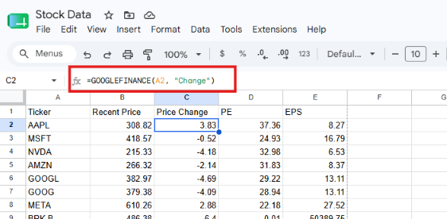
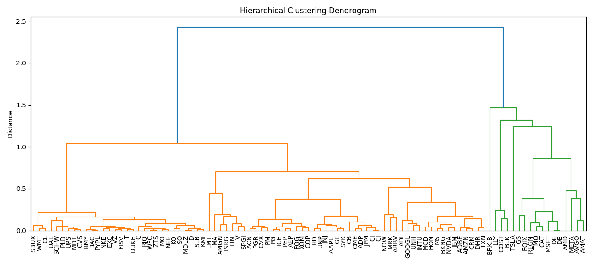

# Portfolio Diversification using Hierarchical Clustering

Unsupervised machine learning pipeline utilizing hierarchical clustering to classify equities based on financial metrics and price dynamics.

## 📌 Overview
This project applies unsupervised machine learning to stock market data to group visually and statistically similar assets. By implementing **Hierarchical Clustering**, the system analyzes patterns in price movements, volatility, and sector behavior to generate diversified portfolio recommendations **without relying on pre-labeled outcomes**.


**Key Project Stages**
* **Automated Data Extraction:** Leverages Google Sheets and the `GOOGLEFINANCE` function to continuously collect real-time stock information and performance metrics.
* **Hierarchical Clustering:** Applies unsupervised learning to construct a dendrogram matrix, mapping out performance patterns and earnings profiles to calculate asset similarity.
* **Portfolio Diversification:** Identifies structural cuts in the dendrogram to isolate unique asset clusters, allowing users to select uncorrelated stocks and minimize risk.

---

## 🎯 Objectives
- **Automate Financial Data Pipelines:** Establish a reliable, real-time data collection system using Google Sheets and the `GOOGLEFINANCE` function to fetch up-to-date stock prices, performance patterns, and earnings profiles.
- **Implement Unsupervised Learning:** Apply Hierarchical Clustering algorithms to naturally group assets based on historical price movements, volatility, and sector behavior without relying on pre-labeled target variables.
* **Visualize Asset Dissimilarity:** Generate an intuitive Dendrogram visualization to clearly map out asset relationships, cluster cuts, and statistical distances between different stocks.
* **Optimize Portfolio Diversification:** Create a data-driven framework that isolates unique asset clusters and extracts uncorrelated stocks to minimize systemic investment risk.
* **Build a Scalable Framework:** Develop clean, reproducible Python code that allows users to easily swap ticker lists or adjust clustering parameters for custom portfolio strategies.

---

## 🛠️ Tech Stack
- **Language:** Python
- **Libraries:** Numpy, Scikit-Learn, SciPy, Matplotlib
- **Tools:** GitHub for version control and documentation  

---

## 📂 Repository Structure
```text
hierarchical-stock-classifications
│── /code        # Python scripts for unsupervised machine learning
│── /data        # Google spreadsheet for data extraction
│── /visuals     # Dendogram, screenshots
│── README.md
```

---

# 📸 Dashboard Preview

## Google Sheets Screenshot


## Dendogram Output



---

# 📥 How to Use
1. **Clone** or download this repository.
2. **Open** the Google Sheets spreadsheet and modify the ticker list to the desired stocks.
3. **Open** the project files in your Python environment. 
4. **Edit** the stock_HC.py file to include the path to the ccdata file on your local machine.
5. **Run** the Python program to generate predictions and view outputs.
